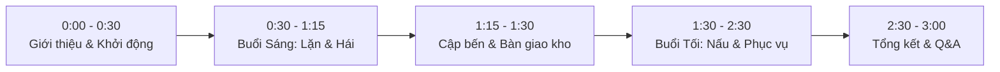

# Kịch Bản Demo 3 Phút — Quán Ăn Chợ Nổi (Team MMMMV)
> **Phụ trách:** Tào Quang Vinh (`@qvinhh2312` — UX + Demo lead)  
> **Thời lượng:** 3 phút (180 giây)  
> **Mục tiêu:** Trình diễn trọn vẹn vòng lặp gameplay 1 ngày của Út Sen: Buổi sáng thu hoạch trên sông Chín Khúc → Bàn giao kho → Buổi tối phục vụ thực khách tại nhà bè Má Tư.

---

## Phân bổ thời gian (180s)

---

## 1. Mở đầu: Bối cảnh & Giới thiệu (0:00 – 0:30)
- **Lời thoại:**
  > "Kính chào thầy và các bạn! Nhóm MMMMV xin giới thiệu dự án *Quán Ăn Chợ Nổi*. Người chơi sẽ hóa thân thành cô bé Út Sen tại chợ nổi miền Tây. Game gồm hai buổi độc lập kết nối qua tệp kho nguyên liệu: Buổi sáng lặn ngụp thu hái trên sông, buổi tối đỏ lửa phục vụ khách tại nhà bè."
- **Thao tác màn hình:**
  - Mở trình duyệt chạy `python3 -m chonoi.live --mode gather`.
  - Chỉ vào giao diện HUD sáng: đồng hồ ⏱, thanh Oxy xanh biển, Máu ♥♥♥ và Giỏ hàng.

## 2. Buổi Sáng: Lặn bắt cá & Hái rau (0:30 – 1:15)
- **Lời thoại:**
  > "Vào buổi sáng, Út Sen bơi trên mặt nước để hái bông điên điển và bông súng bằng phím [E] khi thấy prompt ngữ cảnh màu xanh hiện lên. Sau đó, em lặn xuống sông Chín Khúc, thanh oxy bắt đầu giảm dần. Dưới nước, em áp sát đàn cá linh và cá lóc, nhấn [Space] để bắt cá. Nếu cạn oxy, thanh oxy sẽ đổi màu đỏ cảnh báo và nhân vật mất máu!"
- **Thao tác màn hình:**
  - Di chuyển Út Sen tới nút bông điên điển, nhấn [E] hái (giỏ tăng lên 1 món).
  - Lặn xuống nước, áp sát đàn cá linh, nhấn [Space] bắt cá (hiện thời gian hồi chiêu).
  - Giới thiệu thanh Oxy đổi màu trực quan khi xuống sâu.

## 3. Cập bến & Chuyển giao kho (1:15 – 1:30)
- **Lời thoại:**
  > "Khi giỏ hàng sắp đầy hoặc thời gian sắp hết, Út Sen bơi về bến tàu. Banner `[E] Cập bến & Chốt kho` hiện lên. Nhấn [E], ca sáng kết thúc thành công với lý do `docked`. Toàn bộ nguyên liệu được đóng gói chuẩn JSON vào kho `inventory.json`."
- **Thao tác màn hình:**
  - Bơi về bến tàu [2, 0], nhấn [E].
  - Màn hình kết thúc hiện: `BUỔI SÁNG KẾT THÚC: CẬP BẾN AN TOÀN`, hiển thị sản lượng giỏ.
  - Mở nhanh terminal cho thấy `inventory.json` đã lưu các món thu hoạch.

## 4. Buổi Tối: Nhà bè đỏ lửa phục vụ khách (1:30 – 2:30)
- **Lời thoại:**
  > "Chuyển sang buổi tối với chế độ Quán. Má Tư mở cửa đón khách. Khách bước vào bàn, gọi món lẩu cá linh bông điên điển hoặc cá lóc nướng trui. Thanh kiên nhẫn của khách đếm ngược. Út Sen tới bếp nhấn [E] để nấu; bếp hoàn thành báo `Ready`, em bưng món trên tay và mang ra bàn phục vụ đúng đơn để thu tiền và nhận tiền boa uy tín!"
- **Thao tác màn hình:**
  - Khởi động `python3 -m chonoi.live --mode quan`.
  - Khách vào bàn, Út Sen tới Bếp nhấn [E] nấu món.
  - Bếp chuyển sang xanh lá `Ready`, Út Sen nhấn [E] bưng món (HUD hiện món trên tay 🍲).
  - Mang lại bàn phục vụ, khách ăn, tiền 💰 và uy tín ⭐ tăng lên.

## 5. Kết thúc & Điểm nhấn kỹ thuật (2:30 – 3:00)
- **Lời thoại:**
  > "Khi hết giờ, ca tối tổng kết doanh thu và điểm số chung cuộc. Điểm mạnh của nhóm là tuân thủ 100% contract headless, simulation tất định, HUD hiển thị ngữ cảnh không che khuất vùng chơi và tự động thích ứng an toàn. Xin cảm ơn thầy và các bạn đã lắng nghe!"
- **Thao tác màn hình:**
  - Chỉ vào bảng điểm tổng kết trên màn hình Game Over.
  - Nhấn nút `[🔄 Chơi Lại (Phím R)]` trực tiếp bằng chuột để chứng minh tính năng tương tác mượt mà.
